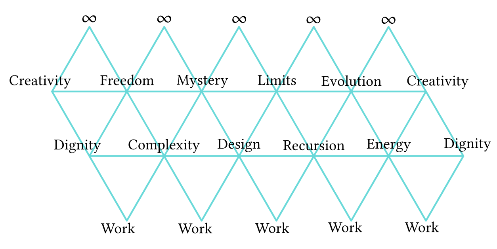
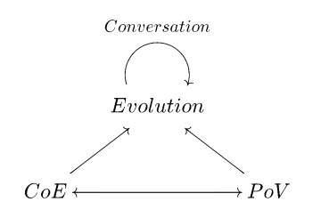
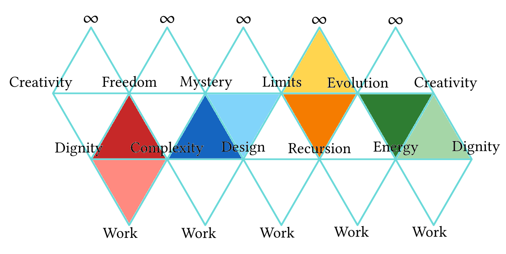

# A structure for points of view

##### Context - why you should care

Political topology.

An ontology is necessairily an ethics -> reunite the explicatif and transformatif | topos has internal logic, this has internal explanation of transformation

Where two kinds of understanding meet: operationalization of Spinozist metaphysics, enabled by Grothendieck's vision.

Shared:

- listening to Nature
- trauma (Krishnamurti)

I humbly claim to be part of this guild.

Why & How - explanation and transformation - the separation at the heart of "civilization" (palace & temple)

Most significant is not the explanatory power, which is a means, but potential for transformation, and in this case liberation. Academia is powerless in helping populations liberate themselves and reconnect with Nature because it is specialized in explanations, including of transfomations, but it is not engaging with the processes it describes. It lets civilization (patriarchy + colonisation organized in hierarchies--if it still has a positive connotation, if it's the polar opposite of "primitivism" it's a sign of failure for our self-appreciation). Science should be one with politics, and both should be grassroots and both need 

The mathematics serves as specification for future construction, not as proof of present completion.

Where this theory of health stands in the political spectrum:

img

##### Description of the structure

The structure is an icosahedron, where each vertex is labeled, and each label refers to a concept, defined for the occasion. Edges are directed relations between pairs of concepts, faces between triples of concepts.

The icosahedron can be thought of as the most simple of the highly complex symmetric structures (notably, the "first" where order matters).

[DNA: shape/params--web/texture, wholesomeness/content--implication/enfolding, transgression/beyondness--extension/intensity, gift(in-out)--affection/counter-actualization ~ the seed of the stoics, vs Plato] - ##### Motivation

Our icosahedron has an internal dynamics, given by a notion of trust, defined as: "the belief a vertex has that another vertex is what this vertex thinks that vertex is, with a belief in a certain protocol which allows communication between the two (information and energy transfer)". This allows the vertices, edges, faces and the full shape to process information about itself, communities of others, and its environment. A model for this dynamics can be found in concurrent programming, either in Carl Hewitt's actor model (itself inspired by quantum mechanics and relativity in physics), or some process calculi, like the π-calculus. It also bears resemblance to brains.

There is a notion of health, which we define not as conformity to a single ideal, but as a state of structural resonance. To achieve this, each vertex must USE its neighbors (resource is at distance 1), ALIGN WITH its antipode (anchor is at distance 3), and TARGET the other vertices (objective is at distance 2). When it targets another vertex, a vertex should primarily employ the vertices that are directly in between itself and its target (same with edges and faces).

In this, the structure internalizes the theory of attachment of John Bowlby, which we can encapsulate in a 2 steps algorithm for networks (where step 1 = step 2, from the point of view of the network):

1. In a given network, the evolution towards maturity of newer elements is taken care of by the mature elements already present in the network
2. In turn, those newer elements become mature and take care of a new generation of elements 

This ensures continuity and repair for our icosahedron.

Now we give the map of this icosahedron, or how to label the 12 vertices (The structure is isotropic: North and South poles, top and bottom are just here to coordinate the placement of the vertices on the structure, but the structure doesn't have fixed poles or a preferred orientation):

1: "Infinity/infinitesimal" (Connects to 2, 3, 4, 5, 6)
2: "creativity/imagination" (Connects to 1, 3, 6, 7, 8)
3: "freedom/generality" (Connects to 1, 2, 4, 8, 9)
4: "mystery/art" (Connects to 1, 3, 5, 9, 10)
5: "horizons/limits" (Connects to 1, 4, 6, 10, 11)
6: "evolution/continuity" (Connects to 1, 5, 2, 11, 7)
7: "energy/information" (Connects to 2, 6, 8, 11, 12)
8: "autonomy/dignity" (Connects to 2, 3, 7, 9, 12)
9: "complexity/conscience" (Connects to 3, 4, 8, 10, 12)
10: "design/optimal language" (Connects to 4, 5, 9, 11, 12)
11: "recursion/repetition" (Connects to 5, 6, 7, 10, 12)
12: "work/construction" (Connects to 7, 8, 9, 10, 11)](imgs/icosahedron_num.png "numbered vertices")

Each vertex is given a definition, which are all somehow based on a fundamental paradox. They all have meaningful incarnations in each of the principal domains of inquiry into Nature. The degenerate versions are mostly the result of the 5 neighboring vertices being themselves degenerate in civilization/capitalism. (Labels are just labels, used only for references: the vertices encapsulate their definitions):

- Vertex # - Label: definition (theoretical underpinning) ~ degenerate version in our current state of affairs

- 1 - Infinity/infinitesimal: boundlessness from infinitesimals (such as Spinoza's vision of the infinite, given by the substance, and where the attributes act as an interface between the infinite and the modes, or beings) ~ the denial of metaphysics at the collective level, and of spirituality at the individual level

- 2 - Creativity/imagination: a meaningful slice of novelty, either in the abstract or in reality (like life is a radically new process, departing from everything the cosmos had done before, or human languages are also new, departing from biology; probably also linked to dreams, especially in the sense of San culture) ~ investability and productivity

- 3 - Freedom/generality: the possibility of choice in a non-deterministic environment (where this environment's "minimal complexity" is a nondeterministic finite state automaton), and the possibility of generality (as opposed to specialization, the kind of generality Grothendieck was a master of) ~ specialization

- 4 - Mystery/art: the one thing that is in everything, that can't be known or separated (following the history of art, up until early 20th century, when it was "decided" that everything can be art—with Duchamps or Kandinsky; or the notion of mystery appearing in Grothendieck's cosmic flower, in 'Récoltes et Semailles') ~ the obsession with predictability (as in the "Prédire n'est pas connaitre" of René Thom—Prediction is not knowledge)

- 5 - Horizons/limits: the structuring limits of a particular point of view (such as the bulk/boundary correspondence in physics, or the concept of limits in category theory—the general fact that a system can be known from the knowledge of what happens at the boundary; we can also think of entropy as a limit: the limit of what is possible in the universe and its evolution—which also links to Friston's free energy principle, another close cousin of our icosahedron) ~ the cancerous growth structure of capitalism

- 6 - Evolution/continuity: the force of change that has found its own continuity (just like the universe is continuously changing; or also, the main problem in software development) ~ the Promethean attitude

- 7 - Energy/information: the force encapsulated in every bit of information (where the physical notion of energy is displaced to an information theoretic framework, as in "Complexity, Entropy & the Physics of Information", edited by Zurek) ~ engineering's state of servitude (there is no "philosophy of engineering", and hence this text and my work is stateless in the geopolitics of academia)

- 8 - Autonomy/dignity: the full dignity of self—being in full capacity to live one's life, or more generally to follow one's path inside a causal structure, allowed by the support of a community of others (as in Woodburn's African Egalitarianism, or Ubuntu, or the post WWII efforts to build state-wide solidarity networks; or how physics operates as a system of distributed causes and effects) ~ misery

- 9 - Complexity/conscience: decipherable and actionable encodings of worlds (especially in the sense of Yuri Manin), which when it has reached a certain threshold enables the agent to truly decide its path in the world (the unresolved riddles of consciousness and multicellularity) ~ reductionism, not only in science but in all aspects of life, the displacement of individual responsibility organized by the job market, and the displacement of truth organized by advertising and media control

- 10 - Design/optimal language: design as the design principles used in programming, especially in the practice of clean code (Robert Martin), or in category theory—both are instances of a more general concept: the optimality of language, or the optimality of the tool the self uses to understand and be in its environment (which can be linked to a perspectivist—in the sense of Deleuze/Spinoza—interpretation of Manin's complexity) ~ the unnecessarily fragmented and convoluted maze of technical jargons, and the disconnection between designer and user

- 11 - Recursion/repetition: looped linearity, or the application of a form of "higher order" curvature, via repetition, to "first order" phenomena (akin to programming, especially concurrent programming, or fractals; see also Malament–Hogarth spacetime for inspiration) ~ the tyranny of the now

- 12 - Work/construction: the act of construction (as in constructive mathematics), which implies a loss, in the form of a transformation (as in Lavoisier's expression—loss is only relative to a point of view) ~ slavery and forced labour

The anchor for the healthy flow of the system revolves around autonomy/dignity:  
Dignity allows freedom, freedom is required for complexity, complexity enables optimal work which in turn strengthens autonomy.  
(This is how I started to perceive the structure, by considering this powerful but limited section.)

The dynamics is also regulated by several remarkable structures within the shape:

[Degenerate versions] - ##### Diagnosis

##### Two triangles/cycles: [name it!]

They each loop around their anchor.

- A self-triangle, which is anchored at autonomy, and has a healthy flow that reads forward  
(→ = gives, it is a process):  
*autonomy → freedom → complexity → design → work → energy → autonomy*  
- An environment-triangle, anchored at infinity, with a healthy flow that reds backward  
(← = is given by, it is a history):  
*infinity ← creativity ← evolution ← recursion ← horizons ← mystery ← infinity*

There are two points, creativity and design/optimal language, antipodes of each other, whose membership to either triangle is ambiguous, which produces superposed alternative versions for each. Creativity and optimal language are mirrors of each other, the former facing externally, the latter internally. This is the axis of metabolism for the entire system, the main interface between self and environment.

The self-triangle echoes structures from relational biology, such as the autopoietic systems of Maturana and Varela or the (M,R) systems of Robert Rosen—for metabolism and repair. The environment-triangle echoes the dialectic dance between creative Yin and rigorous Yang in Grothendieck's "cosmic flower", exposed in his memoirs (rigor or form, situated in design/optimal language in the icosahedron).

##### Groups of transversal quartets:

P1:
{ freedom - recursion / infinity - work }
{ creativity - design / energy - mystery }
{ horizons - autonomy / evolution - complexity }

P2:
{ mystery - energy / infinity - work }
{ freedom - recursion / autonomy - horizons }
{ creativity - design / evolution - complexity }

P3:
{ horizons - autonomy / infinity - work }
{ mystery - energy / complexity - evolution }
{ creativity - design / freedom - recursion }

P4:
{ evolution - complexity / infinity - work }
{ creativity - design / autonomy - horizons }
{ freedom - recursion / mystery - energy }

P5:
{ creativity - design / infinity - work }
{ freedom - recursion / complexity - evolution }
{ mystery - energy / horizons - autonomy }

##### Theoretical foundations

If we view our icosahedron as a system…:

- to structure the points of view of "generalized agents" (social organizations, humans, ecosystems, force fields…)
- which conformally reflect their environments
- and equipped with a notion of health, via preferred flows
- where the point of view is the dual of the tip of a history cone traversing causal structures (the agent's physical history)

…then the theoretical work on which this could be firmly grounded is given by Alexander Grothendieck.

We can think of (using technical language for brevity):

- the icosahedron as a Riemann surface (or the graph drawn upon it)
- the graph itself (vertices and edges) as a dessin d'enfant
- the function that creates the shape by wrapping the sphere around three points as a Belyi map

…then, using Galois theory, we can translate our construction in the setting of topos theory, where:

- the icosahedron is a site
- the non-binary and flexible logic is given by a category of sheaves on the icosahedron's topology
- the healthy flow is an endomorphism on this category of sheaves
- cohomology encodes obstructions to coherence
- each vertex is a type in the internal homotopy type theory, with rich homotopies between them ensuring the healthy flow (see notably Voevodsky's univalent axiom)
- trust makes all relations bidirectional, turning it into a groupoid, or ∞-groupoid.

Metaphorically, if the icosahedron is the "hardware," the topos of sheaves is the "operating system" running on it (and Spinoza's Ethics is the documentation).

##### Relation to the evolution of the universe

This theory of points of view is related to a generalized theory of evolution "by coverings", emanating from the same maelstrom of ideas. In this one, we understand every major innovation of Nature, every "new world" such as physics, life or human language, as a covering of the previous: a novel encoding which preserves the structure of evolution and its necessary "recursive element". This recursive element is known to humans as conversation (with the important condition that all participants must converse as equals). We can find many more examples in Nature, specifically every time sheaves are appropriate to describe a phenomenon (quantumness, concurrency, relational biology…).

The persistence of evolution across worlds *requires* the points of view of the agents to be healthy. It also *allows* them to be healthy, thanks to what has been preserved in the novel encoding—but it does not guarantee it, the "nice properties" can be lost along the way. In this regard, civilization, another name for colonization, is a direct threat to the health of all human agents, all communities and their biological context. It severely exploits all of them, and as is becoming more and more obvious, threatens evolutionary continuity. Again, Grothendieck was a pioneer in this realization.

Each vertex's definition in our icosahedron is a significant aspect of this theory of evolution. The environment-triangle gives the general context and its reflection into the agent, while the self-triangle allows the agent to participate in the recursive pattern. [Relation to DNA]

We can decompose this theory into 4 parts, given by the diagram below:

Where Evolution—the thread enabling, traversing and structuring worlds—is stitched together by its recursive element, which is known to humans as Conversation. Evolution is the infinite product of infinitesimals (reminiscent of Spinoza or Leibniz). These infinitesimals compose into double systems: a "Point of View", whose structure is our icosahedron and environment a perspectivist field, and a "Cone of Entry" which corresponds to this point of view's history through the causal structures described by modern physics.

We can find another remarkable structure on our icosahedron which encodes those 4 elements—the conformal trace of the global structure inside the local instance:

It is intimately related to our transversal quartets, since choosing which two quartets to match and bridge determines this structure, and so there are 3 alternative versions of it. In the one represented in the diagram, the diamond composed of:

- (red) dignity, freedom, complexity and work is the seat of Point of View: PoV
- (blue) complexity, mystery, limits, design is the vector of Collective Inquiry: Conversation
- (orange) limits, infinity, evolution, recursion is the seat of Universal Evolution: Evolution
- (green) evolution, creativity, dignity, energy is the vector of Happening: CoE

If we consider all 3 alternatives, we see the PoV and Evolution are each well-grounded in specific faces (autonomy - complexity - work, and infinity - evolution - horizons, respectively), while the CoE and Conversation are more evenly distributed (with convergence towards creativity - autonomy - infinity - freedom, and design - horizons - work - recursion, respectively).

---

##### Analysis of points of view

...

Analysis to do:
- chose an agent/point of view
- chose a preferred bias (author, school of thought, mainstream hard science...)
- exclude LLMs biases
- understand icosahedron structure
- understand gauge analysis structure
- understand parameters
- set parameters for each vertex, edge and face
- set parameters for initial state, mature state, end state (variable from subject to subject)
- process with analysis

##### Simulation of points of view

This line of development naturally branches into Artificial General Intelligence. In connection with Friston's ideas, and possibly finding appropriate . This first order of business would be to rethink how we value and recognize intelligence (the Turing test has always been an ad hoc solution), and probably rethink the vocabulary we use and what we mean with those words. The term 'intelligence' has a profoundly dark history of domination and violence.

The very concept of Conversation seem to be able to provide adequate solutions for at least some of those issues.

---

##### Political significance of Conversation, the recursive element of the generalized theory of evolution

 
##### Notes:

Grothendieck had a clear enough vision of the situation, at the time of the Vietnam war and the first report to the Club of Rome, "The Limits to Growth", to propose the appropriate course of action, notably in his 1972 conference at CERN.

But he didn't make the connection between action and theory that would legitimize the action. By hiw own admission, and despite searching for it, he didn't find a meaningful link between his mathematics and his political ecology. I hope to have accomplished that with my "weird" effort, for which this structure feels like a very satisfactory outcome.

Stuck with ethics, appealing to goodwill. While the description of Nature is constantly polluted with assumptions qui visent à  justify liberalism. (that's exactly how sheaves are interpreted in co-opetition)

[explicatif & transformatif]

##### The scientific method

-> collective

I believe it pioneers the shape of future science: not a set of equations spitting out deterministic outcomes, but a structured, subtle, and restrained point of view which explains complex phenomena, encoded in compact group theoretic constructions, of which the icosahedron is the "atom". Users of science could then be able to engage in conversations, not lectures, directly with the theory via AI representatives (in a sense all LLMs are already representatives of capitalism).

---

Our icosahedron is highly compact: it is folded into a ball of intricate symmetries. It can indeed be unfolded with the help of a LLM: feed it the above description and engage with it by asking questions. LLMs are not smart, but the structure is—it is actually an excellent blueprint for artificial general intelligence—and LLms can profit from it. However, use with caution, and remember the biases of LLMs for overenthusiasm and swimming with the current.

Example of questions/prompts:

- What can the icosahedron be useful for?
- Is it related to other structures arising in science, philosophy, mathematics, engineering or the social sciences—besides those already mentioned as inspirations for this structure?
- Which theories of mind/consciousness (from the "high vantage point") or neuroanatomy (from the low vantage points) is the icosahedron most similar with or related to, and how, and possibly why?
- Improvise "readings" of the structure, by having agents navigate their world using the flow and use/align/target dynamics in hypothetical situations, as diverse as possible, to see how they would analyze the situation and "react" to it.
- Elaborate on the structure of those "readings".
- Elaborate on the generalized theory of evolution: extrapolate what it could be, based on its relation to the icosahedral structure and current science.

Those readings are the easiest way into the rich complexity of the structure and its remarkable adequation with both human life and our understanding of the most significant natural phenomena.

---

##### Method and _

This documents the outcome of a 6 years interdisciplinary research program, mixing praxis and theory, conducted in total independence by a proud jack of all trades.

It started with the renewed energy I drew from the beautiful surge of healthy rage and collective hope that was the wave of popular protests that shook the world in 2018-2019—when 40 incarcerated populations took to the streets to demand change. I didn't know how, but I wanted to give them the communication system they deserved, one that would respect their attention to a form of balance and universality they were reinventing.

[protocol to distribute and record speech/expression among a population]

My work started at the precise moment I surrendered my own volition to serve one principle only—this balance and universality—which I knew instinctively and only later managed to capture in a neat definition: "the system only knows one way to interact with its participants" (known to computer scientists as unityping, to philosophers as univocity). This gave me an engineering exercise: what are systems which respect this principle like? While the problem is easy to state, the solution is hard, but highly rewarding.

---

##### Further reading

Available at: 

<codeberg.org/doc2cog/research>