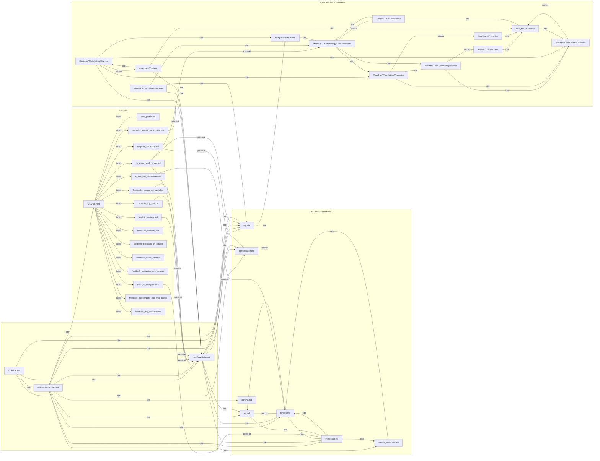

# Reference graph — workflow/ + memory/ + Agda

The edges between files in `inventory.md`. Two views: a Mermaid graph (clustered), then an explicit edge list with the line numbers where each reference lives.

Edge labels:

- **anchor** — a `→ T*n*` / "§N" pointer used to navigate within a fixed scaffold (arc ↔ targets, status ↔ arc)
- **cite** — narrative reference ("see X for Y")
- **defines** — file is the canonical home of a concept that others mention
- **mirrors** — analytic file is the postulate-free counterpart of a synthetic file
- **points-at** — memory pointer to the canonical workflow location

---

## 1. Mermaid graph (high-level)



---

## 2. ASCII topology (orientation)

```
                          CLAUDE.md  (loaded always)
                              │
                              ▼
                       workflow/README.md      (focused vs architecture path)
                              │
                ┌─────────────┴──────────────┐
                ▼                            ▼
         status.md  ◀──────────── architecture-path files (workflow/)
       (focused path)                       │
                                ┌──────┬────┴───┬───────┬──────┬─────┐
                                ▼      ▼        ▼       ▼      ▼     ▼
                              motiv  arc ⇄ targets  conv   rug   related
                                                                  naming
              memory/ (parallel reference layer, points back at the above)
              CLAUDE.md ── cites ──▶ status / conversation / rug
              Agda headers ── cite ──▶ status / rug / AnalyticTest README
```

---

## 3. Explicit edge list with line refs

Format: `source(line) → target — label`. Anchors that occur many times in one file are folded.

### 3.1 `CLAUDE.md` → workflow

| Edge | Cite |
|---|---|
| CLAUDE.md → workflow/README.md | "Start with `workflow/README.md`" (`CLAUDE.md:36`) |
| CLAUDE.md → workflow/status.md | "Track blockers in `workflow/status.md`" (`CLAUDE.md:18`); `CLAUDE.md:37`, `:42` |
| CLAUDE.md → conversation.md | "`workflow/conversation.md` explicitly rejects 'site is S¹'" (`CLAUDE.md:7`) |
| CLAUDE.md → rug.md | "`workflow/rug.md` for what the differential level would cost" (`CLAUDE.md:9`) |

### 3.2 `workflow/README.md` → all architecture-path files

Single page of cites; each is the canonical introduction to the target file.

| Edge | Cite |
|---|---|
| README → status.md | `README.md:7`, `:18` |
| README → motivation.md | `README.md:15` |
| README → arc.md | `README.md:16` |
| README → targets.md | `README.md:17` |
| README → conversation.md | `README.md:22` |
| README → rug.md | `README.md:23` |
| README → related_structures.md | `README.md:24` |
| README → naming.md | `README.md:25` |
| README → memory/ | `README.md:29` |

### 3.3 `status.md` → architecture-path

| Edge | Cite |
|---|---|
| status → arc.md | `status.md:5` ("articulated in `workflow/arc.md`"), `:7` |
| status → targets.md | `status.md:5` (T7), `:9` (T2, T4, T5), `:60` ("migrated from conversation.md") |
| status → motivation.md | `status.md:5` |
| status → rug.md | Not a direct cite — referenced implicitly via "imported soundness" framing; rug.md back-refs status.md instead. |
| status → conversation.md | `status.md:60` ("Note migrated from `conversation.md`") |

### 3.4 Architecture-path internal: arc ⇄ targets (the dense pair)

Bidirectional anchors. Lines below are where the anchor sits in each file.

| arc.md section | arc.md line | targets.md back-anchor |
|---|---|---|
| §3 Structural claim → T1 | `arc.md:19` | T1 § header `targets.md:11` |
| §4 What the triple says → T1 (data), T6 | `arc.md:31` | T1 `targets.md:11`, T6 `targets.md:96` |
| §5 Sites and folders → T2, T4, T5 | `arc.md:47` | T2 `targets.md:28`, T4 `targets.md:64`, T5 `targets.md:80` |
| §6 Math fragment → T3 | `arc.md:57` | T3 `targets.md:46` |
| §7 Interpretation → T6 | `arc.md:68` | T6 `targets.md:96` |
| (§6 also implied by T7) | — | T7 `targets.md:112` cites arc.md §6 |

### 3.5 Other architecture-path edges

| Edge | Cite |
|---|---|
| motivation.md → arc.md, targets.md, related_structures.md | `motivation.md:3` |
| targets.md → motivation.md, arc.md, related_structures.md | `targets.md:3-5` |
| rug.md → status.md | `rug.md:14` (♯/ʃ idempotency cite of status.md Open Questions) |
| rug.md → AnalyticTest/README.md | `rug.md:42` ("deferred to `agda/AnalyticTest/`") |
| rug.md → Cohesion.agda | `rug.md:7` (the `flat-intro` flag) |

### 3.6 Memory → workflow (points-at)

Memory entries are short and almost all carry a single "How to apply" or "Canonical definition" pointer back into `workflow/`.

| Memory | Points at |
|---|---|
| `MEMORY.md` | indexes the 15 files below |
| `user_profile.md` | (no workflow pointer — user-level) |
| `negative_anchoring.md` | `conversation.md` (`negative_anchoring.md:7`) |
| `math_is_subsystem.md` | `motivation.md` (`math_is_subsystem.md:7`) |
| `b_side_site_icosahedral.md` | `targets.md` T2, T3, T4, T5 (`b_side_site_icosahedral.md:9-11`) |
| `analytic_strategy.md` | `status.md` (Decisions Log entries on crisp contexts) |
| `de_rham_depth_ladder.md` | `rug.md` "Beyond fracture", `status.md` live status, `FlatCoefficients.agda` top comment (`de_rham_depth_ladder.md:13`) |
| `decisions_log_split.md` | `status.md` Decisions Log |
| `feedback_memory_not_workflow.md` | workflow/ in general |
| `feedback_propose_first.md` | (workflow convention, not a specific file) |
| `feedback_precision_on_cubical.md` | (no file pointer) |
| `feedback_status_informal.md` | `status.md` |
| `feedback_postulates_over_records.md` | (no file pointer; references `shape-map-id` etc. in Properties.agda) |
| `feedback_analytic_folder_structure.md` | `agda/ModalHoTT/` ↔ `agda/Analytic/ModalHoTT/` |
| `feedback_independent_legs_then_bridge.md` | `targets.md` T1 |
| `feedback_flag_workarounds.md` | (no file pointer) |

### 3.7 Agda → workflow (and Agda ↔ Agda)

Synthetic files mostly cite each other and `status.md`; analytic files cite their synthetic counterparts. Selected edges; full mapping in `code_connections.md`.

| Edge | Cite |
|---|---|
| `Cohesion.agda` (header) → `Adjunctions.agda` | `Cohesion.agda:10` |
| `Adjunctions.agda` (header) → `Properties.agda` | `Adjunctions.agda:14-16` (the `shape-flat-natural-B` cross-ref) |
| `Properties.agda` (postulate header) → `status.md` Open Questions | `Properties.agda:95-96` |
| `Properties.agda` (postulate header) → `FlatCoefficients.agda` | `Properties.agda:96` |
| `Fracture.agda` (header) → `status.md` Open Questions | `Fracture.agda:25` |
| `Fracture.agda` (header) → `workflow/status.md` "Discussion of the next step" | `Fracture.agda:46` |
| `Fracture.agda` (header) → `Analytic/.../Cohesion.agda` sharp-for-Bℤ block | `Fracture.agda:33-35` |
| `Discrete.agda` (header) → `status.md` + `rug.md` | `Discrete.agda:25-29, :41-43` |
| `Discrete.agda` (header) → `Cohomology/FlatCoefficients.agda` | `Discrete.agda:46-48` |
| `FlatCoefficients.agda` (header) → `Properties.agda` | `FlatCoefficients.agda:99-100` |
| `Analytic/.../Fracture.agda` → `status.md` | `Analytic/.../Fracture.agda:23-24` |
| `AnalyticTest/README.md` → synthetic plan (de Rham depth) | `AnalyticTest/README.md:11` |

### 3.8 Mirror pairs (synthetic ↔ analytic)

The two-track convention. Every synthetic file under `agda/ModalHoTT/Modalities/` (and `Cohomology/`) has a postulate-free mirror under `agda/Analytic/ModalHoTT/`.

| Synthetic | Analytic mirror | Mirror status |
|---|---|---|
| `Modalities/Cohesion.agda` | `Analytic/.../Cohesion.agda` | Full mirror + Bℤ centrepiece `¬-IsFlatModal-delooping` |
| `Modalities/Adjunctions.agda` | `Analytic/.../Adjunctions.agda` | ℤ only (idEquiv); Bℤ documented as diagnostic obstruction `maps-into-integers` |
| `Modalities/Properties.agda` | `Analytic/.../Properties.agda` | ℤ trivial mirror; Bℤ flat-map blocked, shape trivial, sharp deferred |
| `Modalities/Fracture.agda` | `Analytic/.../Fracture.agda` | ℤ only (collapses to `Σ ℤ singl`); Bℤ excluded |
| `Modalities/Discrete.agda` | (no mirror) | Drafted, not imported (`status.md:115`); analytic mirror not yet drafted |
| `Cohomology/FlatCoefficients.agda` | `Analytic/.../FlatCoefficients.agda` | Both ℤ and Bℤ collapse to `idEquiv` (both already shape-modal) |

---

## 4. Outdegree / indegree summary

| File | Outdegree (refs out) | Indegree (refs in) |
|---|---:|---:|
| `status.md` | 5 | high (CLAUDE.md, README.md, rug.md, 4 memory entries, 5 Agda files) |
| `arc.md` | 4 (targets ×5 anchors, motivation, README) | high (status, targets, README, CLAUDE.md, motivation) |
| `targets.md` | 4 (arc ×6 anchors, motivation, related, README) | high (status, arc, README, 2 memory entries) |
| `motivation.md` | 3 (arc, targets, related) | mid (README, status, targets, math_is_subsystem) |
| `conversation.md` | 0 explicit refs out | mid (README, CLAUDE.md, negative_anchoring memory, status:60 migration) |
| `rug.md` | 3 (status, AnalyticTest, Cohesion.agda) | mid (README, CLAUDE.md, de_rham_depth_ladder memory, Discrete.agda) |
| `related_structures.md` | 0 | low (README, motivation, targets) |
| `naming.md` | 0 | low (README only) |
| `MEMORY.md` | 15 (index) | 0 (loaded directly) |

Hubs by indegree: `status.md` (highest), then `arc.md` and `targets.md` tied. `naming.md` and `related_structures.md` are leaf reference files. `conversation.md` is a sink (no outgoing refs; pure correction layer).
